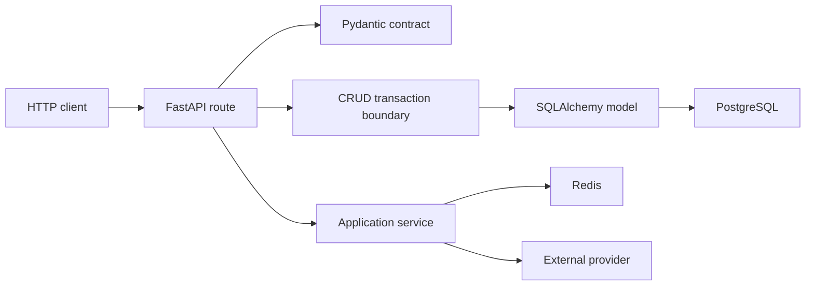
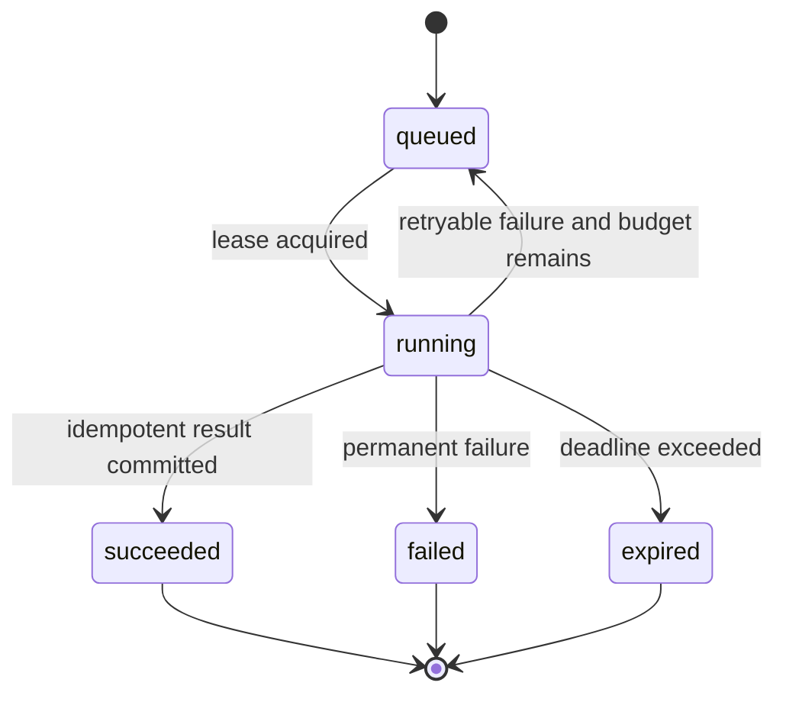

# Architecture

## Request Flow

Routes validate input, enforce identity and authorization when present, invoke CRUD or services, and map results to public schemas. Routes do not execute SQLAlchemy operations directly.

## Durable Work

Adopting projects should model background work as explicit state machines:

Each task needs a stable ID, owner, status, attempt count, retry budget, available time, lease owner, lease expiry, terminal evidence, timestamps, and an idempotent finalization rule. Exact schema decisions require human confirmation.

## Boundaries

- `app/api/routes`: HTTP-only concerns and orchestration.
- `app/schemas`: versioned public contracts.
- `app/db/crud`: transactions, locks, persistence queries, and returned plain data.
- `app/db/models`: storage representation and database invariants.
- `app/services`: provider adapters and multi-step use cases.
- `app/workers`: durable execution; not included in the minimal example.
- `migrations`: the only reviewed path for schema evolution.

## Example Feature

`example_items` proves the complete route → CRUD → model → migration → integration-test path. It is intentionally replaceable and must not become an accidental shared abstraction.

## Runtime Dependencies

- Python 3.12+
- FastAPI and Pydantic
- SQLAlchemy async with psycopg
- PostgreSQL
- Redis
- Alembic
- uv for locked dependency and interpreter management

## Decisions Still Required In An Adopted Project

- Identity and authorization model
- Multi-tenancy and ownership
- Public versus internal API versioning
- Transaction and consistency boundaries
- Idempotency-key scope and retention
- Soft versus hard deletion
- Timeouts, retries, deadlines, cancellation, and leases
- Audit and observability requirements
- Secret, provider, and personal-data handling

Record durable decisions in `docs/adr/` before encoding them into schema or public behavior.
